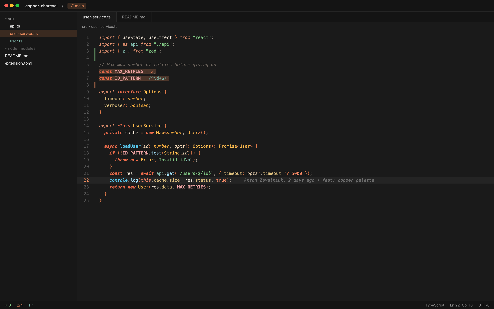
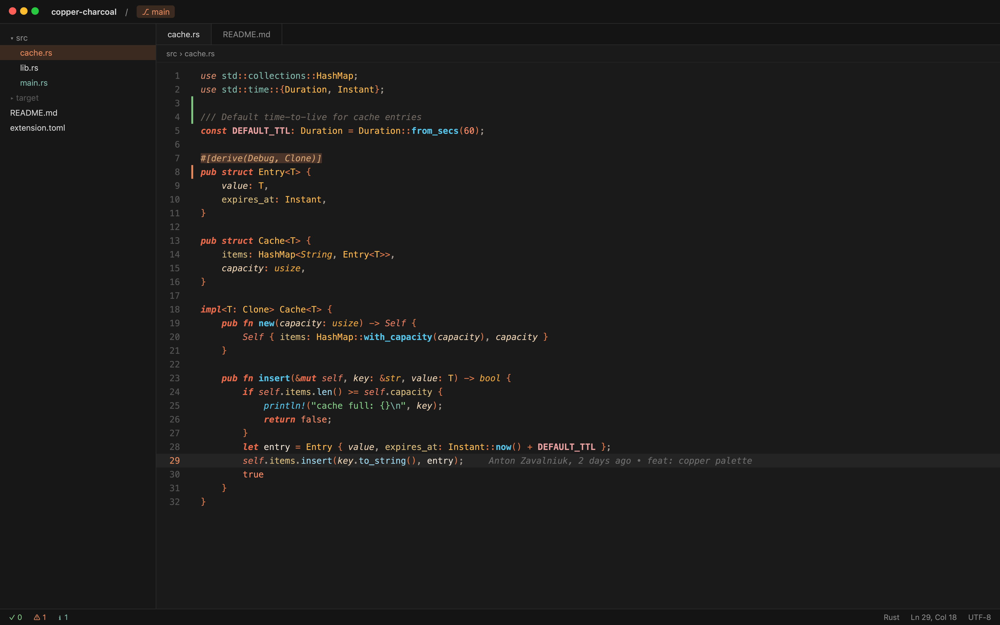
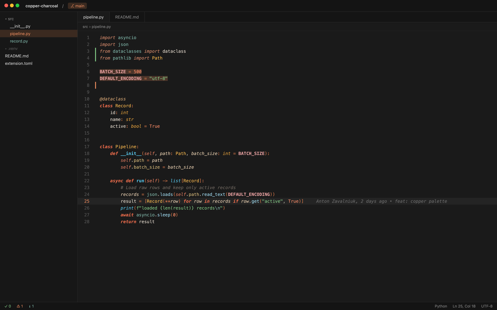

# Copper Charcoal Theme for Zed

A meticulously crafted dark theme for the Zed editor, designed to balance deep charcoal surface tones with warm copper accents, a touch of verdigris patina, and crisp visual hierarchy.

---

## Key Features & Design Nuances

### 1. Deep Charcoal Canvas & Panel Hierarchy

- **Rich Charcoal Canvas (`#1a1a1a`):** The primary editor background uses a deep, ultra-dark charcoal surface that keeps contrast high without causing visual fatigue during extended coding sessions.
- **Distinct Frame Layers (`#141414` – `#171717`):** The tab bar, title bar, status bar, and side panels use darker, recessed tones to clearly frame your workspace.
- **UI Elements & Surface Depth (`#222222` – `#404040`):** Menus, popups, and elevated panels maintain step-by-step depth cues for seamless navigation.
- **Copper Selection (`#3a2a20`):** Selected tabs, list items, and buttons use a dark copper tint instead of the default blue.

### 2. Tailored Syntax Highlighting

Every token category gets its own hue, weight, or style, so code never blends into a single warm blur.

| Category | Color | Style |
|---|---|---|
| Keywords & tags | `#e86a4a` rust copper | semibold italic |
| Imports / exports | `#d4896a` muted copper | italic |
| Functions | `#56c2e6` sky azure | semibold |
| Methods | `#9ed8ee` light azure | — |
| Built-in functions | `#56c2e6` sky azure | italic |
| Variables | `#e6dccf` warm white | — |
| Parameters | `#e8cfb0` cream | italic |
| `self` / `this` | `#e07a5f` terracotta | italic |
| Properties & fields | `#d6b97a` brass | — |
| Constants | `#e8a0a0` rose gold | semibold |
| Numbers & booleans | `#ff8a65` peach coral | — |
| Types, enums, constructors | `#ffb74d` golden amber | — |
| Built-in types | `#e6a23c` dark amber | italic |
| Namespaces & modules | `#7fb5a8` verdigris patina | — |
| Attributes & decorators | `#d4a373` bronze | italic |
| Strings | `#81c784` sage green | — |
| Regex & escape sequences | `#7fb5a8` verdigris patina | — |
| Operators & brackets | `#d97749` burnt copper | — |
| Punctuation | `#a39a91` warm grey | — |
| Comments | `#6e665f` warm charcoal grey | italic |

All colors meet WCAG AA contrast (≥ 4.5:1) against the editor background, except comments, which are intentionally subdued.

### 3. Integrated Diagnostics & VCS Statuses

- **Diagnostics:** Errors are flagged in vibrant rose (`#f06292`), warnings in warm copper (`#e5885c`), and info notifications in verdigris patina (`#7fb5a8`), each with a soft tinted background and border.
- **Git Status:** Added files glow in sage green (`#81c784`), modified in copper (`#e5885c`), renamed in patina (`#7fb5a8`), conflicts in amber (`#ffb74d`), and deletions in rose (`#f06292`). Gutter diff markers follow the same palette.
- **Inline Blame & Hints (`#6b6b6b`):** Subdued grey keeps inline git blame and hints readable but out of the way.

### 4. Active Navigation Cues

- **Copper Cursor & Selection (`#e5885c`):** The cursor glows copper, and text selection uses a translucent copper wash.
- **Active Line Focus:** The current line number glows copper (`#e5885c`) against a soft overlay (`#242424`).
- **Focused Borders:** Active split panes, panels, and focus rings stand out with a signature copper border (`#e5885c`).
- **Search & References:** Search matches use a translucent amber highlight; symbol references use a subtle copper tint.

### 5. Terminal

A full 16-color ANSI palette tuned to the theme: rose, sage, amber, sky, orchid, and cyan, with bright and dim variants.

### 6. Theme Preview

**TypeScript**

**Rust**

**Python**

